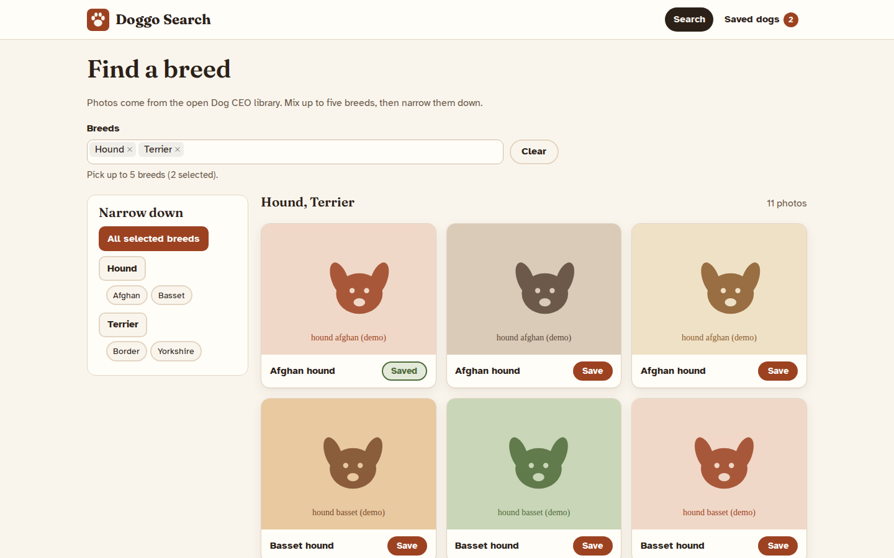
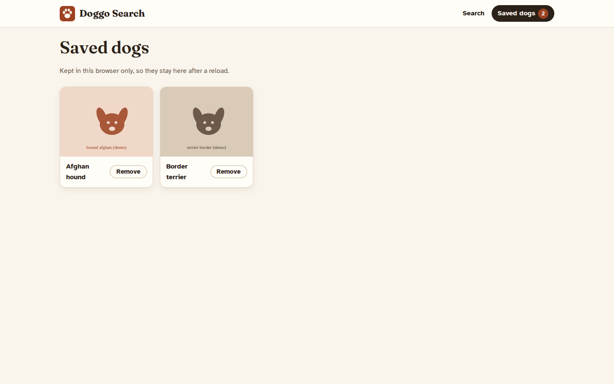
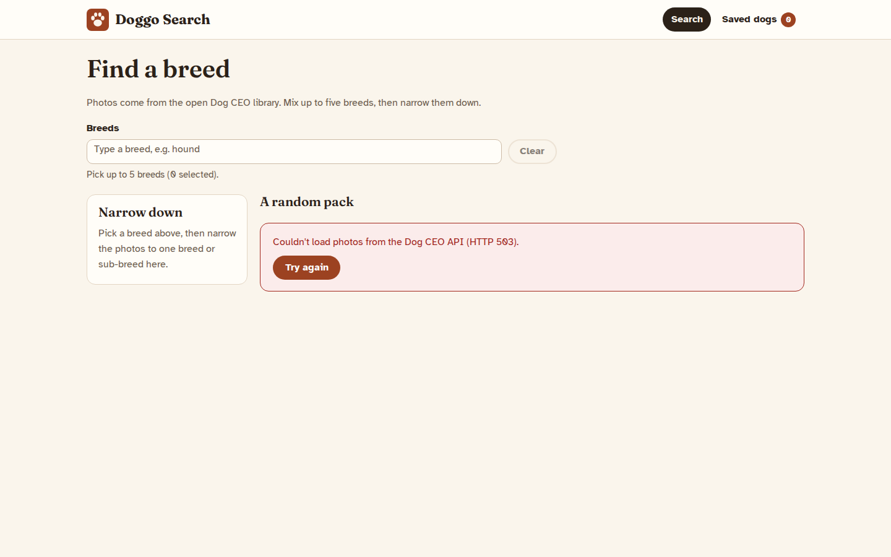
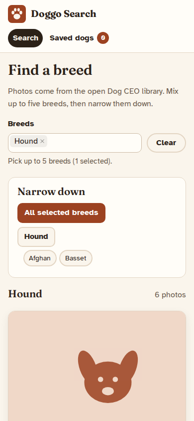
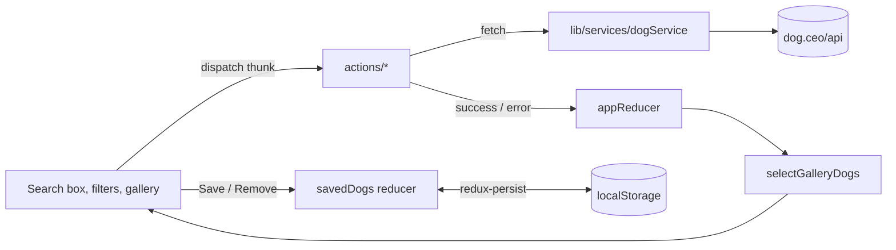

# Dog Breed Finder

Doggo Search is a small React and Redux app for browsing dog photos by breed. It reads the free [Dog CEO API](https://dog.ceo/dog-api/), lets you mix up to five breeds in one gallery, narrow the results to a single breed or sub-breed, and keep a list of favourite photos in the browser.

It needs no API key and no backend of its own: the build is a static bundle.



<sub>Screenshots use generated placeholder images served from test fixtures, not real Dog CEO photos.</sub>

## What it does

- Loads the full breed list into a searchable multi-select (up to five breeds at a time).
- Starts with a random pack of 50 photos, then switches to the selected breeds.
- Lists each selected breed's sub-breeds as filters; picking one loads that sub-breed's photos.
- Pages through results 12 at a time, starting again at page 1 whenever the selection changes.
- Saves or unsaves any photo with one button; the "Saved dogs" page lists them and lets you remove them.
- Shows loading placeholders, empty results, and API failures with a **Try again** button.

| Saved dogs | API down | Phone |
| --- | --- | --- |
|  |  |  |

## Running it

You need either Docker or Node 22 (see `.nvmrc`).

**With Docker**, which builds the bundle and serves it from nginx:

```bash
docker build -t doggo-search .
docker run --rm -p 8080:80 doggo-search
```

Then open http://localhost:8080. nginx sends unknown paths to `index.html`, so reloading `/saved-dogs` works.

**With Node**, for development:

```bash
npm ci
npm run dev        # Vite dev server on http://localhost:5173
```

| Script | What it runs |
| --- | --- |
| `npm run dev` | Vite dev server with hot reload |
| `npm run build` | Production bundle in `dist/` |
| `npm run preview` | Serves `dist/` locally |
| `npm test` | Vitest suite, once |
| `npm run test:watch` | Vitest in watch mode |
| `npm run lint` | ESLint |

There are no environment variables. The API base URL is set in `src/lib/services/baseService.js`.

## How it works



The Dog CEO API returns bare image URLs. The breed is read from the image folder, so `.../breeds/hound-afghan/n02088094_1003.jpg` becomes `{ breed: 'hound', subBreed: 'afghan' }` and is labelled "Afghan hound". A typical response looks like this:

```http
GET https://dog.ceo/api/breed/hound/list
```

```json
{ "message": ["afghan", "basset", "blood", "english", "ibizan", "plott", "walker"], "status": "success" }
```

## Design notes

- **One source of truth for the gallery.** The reducer stores images per selected breed (`dogsByBreed`), the random set, an optional `filter` and the sub-breed results. `selectGalleryDogs` derives what is shown, in this order: active filter, then selected breeds, then the random pack. Deselecting a breed drops its data, and a filter on that breed is cleared with it.
- **Only new breeds are fetched.** Adding a breed requests its images and sub-breeds once. Removing one makes no request.
- **Late responses are ignored.** A sub-breed response that arrives after the filter has changed is discarded, so a slow request can't replace what you are looking at.
- **Only saved dogs are persisted.** Search results are not kept across reloads. A redux-persist migration carries saved dogs over from the older format, which stored the whole state.
- **`fetch` instead of axios.** The app makes five GET requests; a 10-line wrapper covers them. That also lets the tests intercept every call with MSW.
- **antd for the hard widgets only.** The accessible multi-select and the pagination come from antd 6, themed to the app's palette. Cards, filters and buttons are plain HTML and CSS.
- **Accessibility.** The page has landmarks and a skip link, and the breed picker has a label and a described limit. Filters and Save are toggle buttons (`aria-pressed`), focus rings are visible, and text colours meet WCAG AA.

## Tests

```bash
npm test
```

There are 27 Vitest tests in jsdom. They cover the URL parsing and naming helpers, both reducers, the gallery selector, the thunks and the persist migration. They also run the main flows through the UI: search, sub-breed filtering, save and remove, and recovery after an API error. MSW answers every Dog CEO request from fixtures in `src/test/`, and unhandled requests fail the test, so the suite runs offline.

## Project layout

```text
src/
├── actions/          thunks: breed list, random pack, selection, filters, saving
├── components/       Navbar, SearchBar, DogFilters, DogCards, Home, SavedDogs
├── containers/       DogsContainer wires the search page to the store
├── lib/              image URL parsing, display names, Dog CEO client
├── Reducers/         gallery state, saved dogs, selectors
├── stylesheets/      design tokens and layout
├── test/             MSW server and fixtures
├── store.js          store factory and persistence config
└── theme.js          antd theme tokens
```

## Limitations

- Photos and breed data come from Dog CEO. Availability, image licensing and the response format are outside this project's control.
- Saved dogs live in one browser's localStorage and point at remote image URLs. If an image is removed upstream, it breaks.
- antd makes up most of the ~190 kB gzipped bundle.

## Licence

MIT. See [LICENSE](LICENSE).
